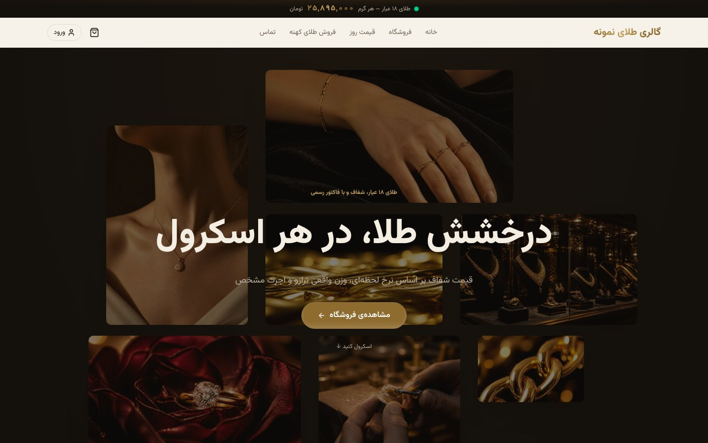
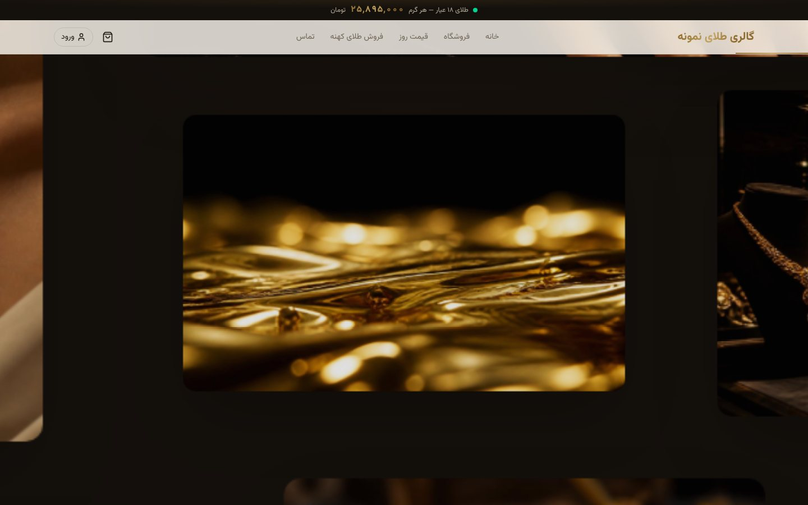
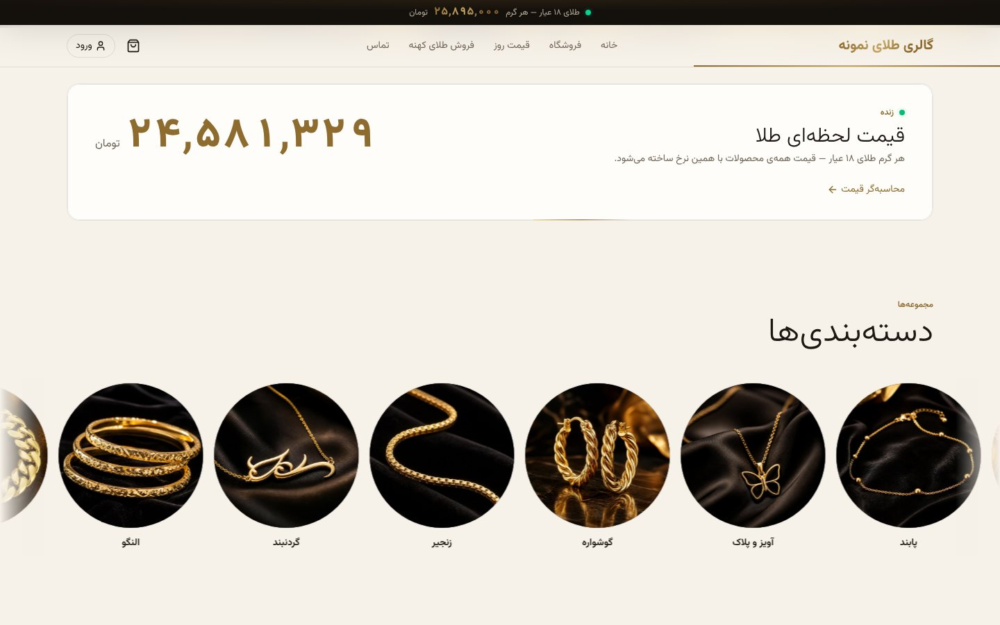
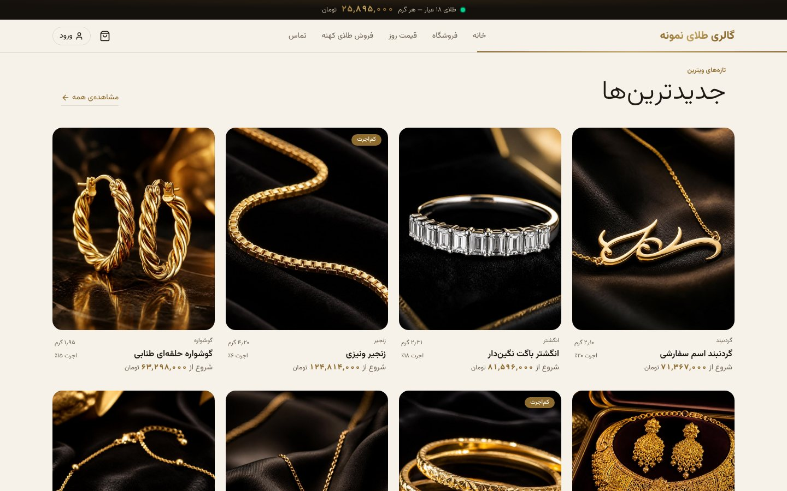
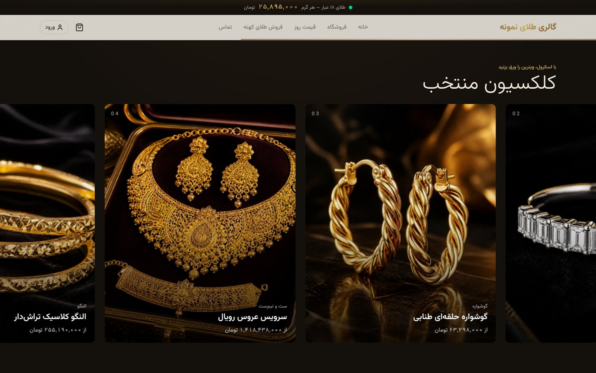
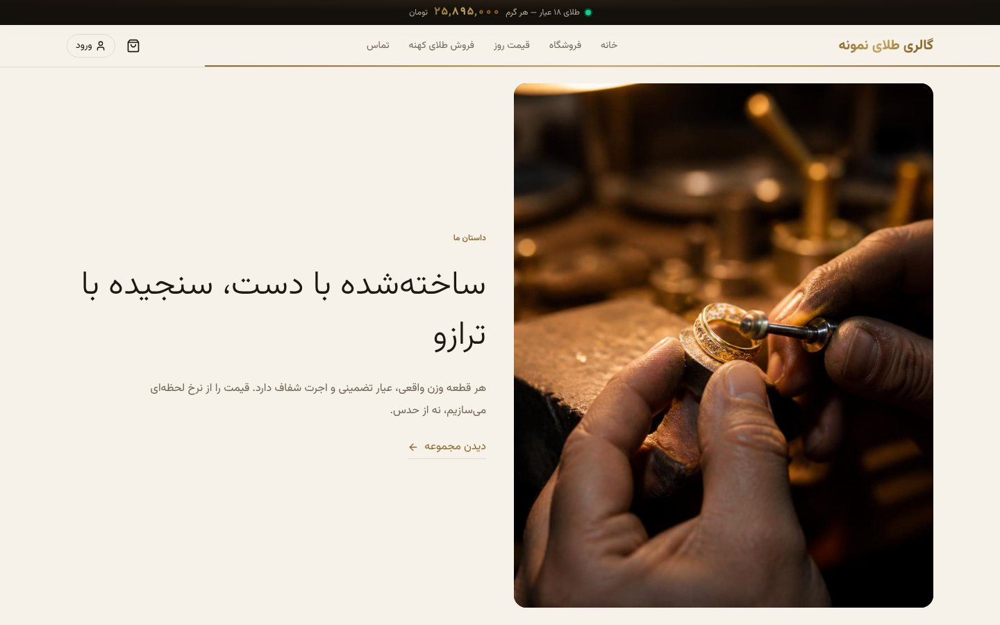
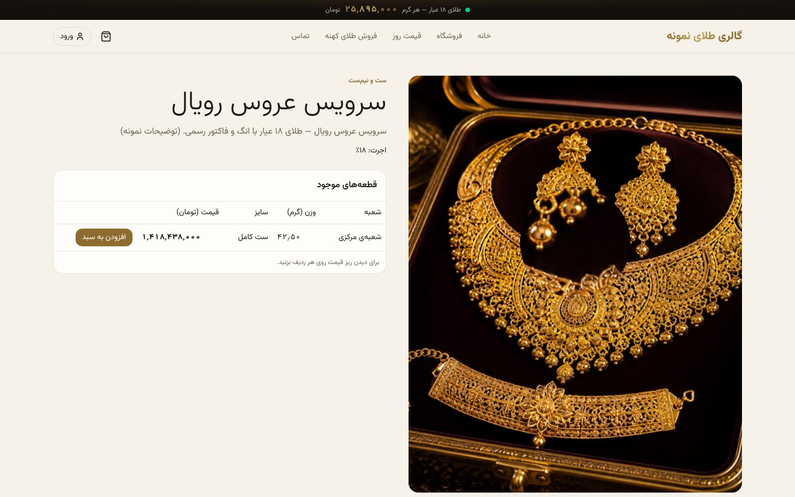
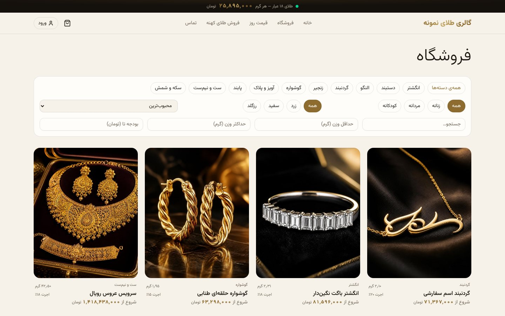
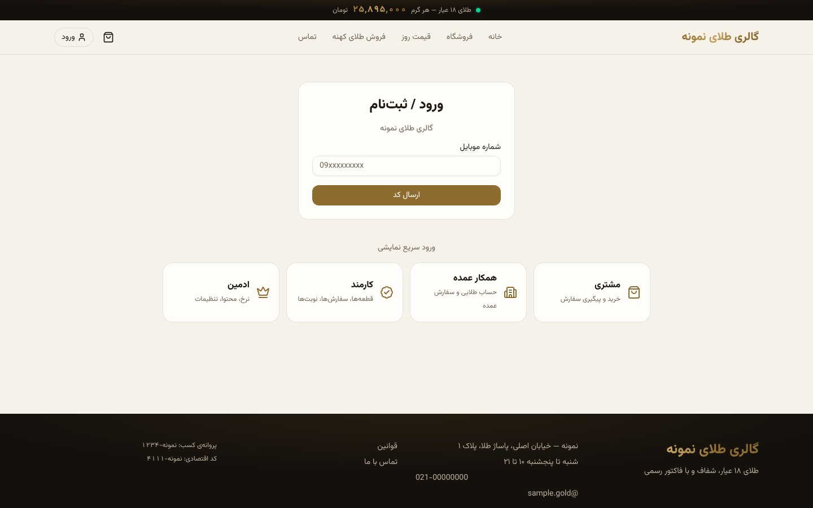
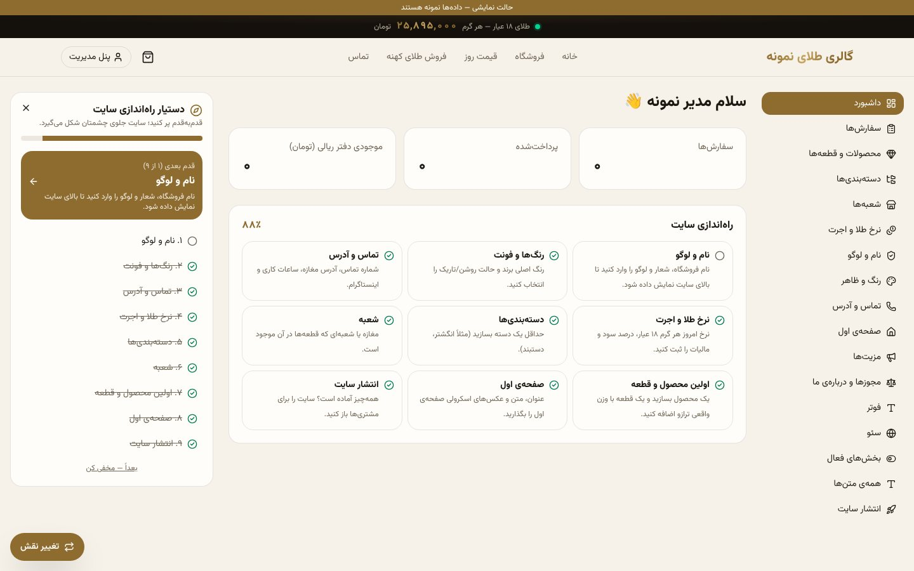

# Goldgalerie – White-Label-Onlineshop für Goldschmuck

> 🤖 **Dieses Projekt ist durch Vibe Coding mit Claude (KI von Anthropic) entstanden.**
> Idee, Entscheidungen und Designrichtung stammen von Amir; Code, Design, Tests und Dokumentation sind im Dialog mit Claude entstanden.

Ein Onlineshop für Goldschmuck mit Live-Preisen, wie er im Iran üblich ist: Der Preis jedes Stücks wird aus **Tageskurs × tatsächlichem Gewicht × Feingehalt + Arbeitslohn + Gewinn + Steuer** berechnet. Alle Texte, Farben, das Logo und die Seiten lassen sich im Admin-Bereich ändern. Zusätzlich gibt es eine leere Installation, mit der ein neuer Kunde seine eigene Website über einen 9-Schritte-Assistenten aufbaut.

Die Oberfläche der Website selbst ist auf Persisch (von rechts nach links), weil sie für den iranischen Markt gedacht ist.

> Vollständige Projektkarte: `docs/PROJECT_MAP.html` (im Browser öffnen) · Standards und Skills: `docs/SKILLS.md` · Komponenten von 21st.dev: `docs/21st-components.md`

## Screenshots

**Startseite – Hero mit Bild-Zoom beim Scrollen (kein Video)**


| Bild-Zoom beim Scrollen | Live-Goldkurs + Kategorien |
|---|---|
|  |  |

| Neueste Produkte | Ausgewählte Kollektion (horizontales Scrollen) |
|---|---|
|  |  |

| Markengeschichte | Produktseite (Lupe auf 4K-Foto + Tabelle der Einzelstücke) |
|---|---|
|  |  |

| Shop mit Filtern | Login mit 4 Demo-Buttons |
|---|---|
|  |  |

| Admin-Bereich + Einrichtungsassistent | Mobilansicht |
|---|---|
|  |   |

## Funktionen

- **Live-Goldkurs** über SignalR; alle Preise werden serverseitig neu berechnet (Geld als Ganzzahl in Rial, Gewicht in Milligramm, Prozente in Basispunkten).
- **Preissperre** im Warenkorb für 10 Minuten; der Online-Verkauf stoppt automatisch bei veraltetem Kurs oder großem Kurssprung.
- **Einzelstücke statt Varianten:** Jedes Schmuckstück hat sein eigenes Gewicht, seine Größe und seine Filiale.
- **White-Label:** Name, Logo, Farben, Startseiten-Blöcke, alle Texte, Kontakt, SEO – alles im Admin-Bereich.
- **Ratenkauf-Rechner** (Anzahlung in %, Anzahl der Monatsraten, Obergrenze, optionale Gebühr – im Admin einstellbar).
- **„Inhaber im Mittelpunkt“-Bereich:** Foto, Zitat, kurze Videos (MP4-Upload oder Instagram-Reel) und Kauftipps.
- **WhatsApp-Bestellung:** schwebender Button und „Per WhatsApp bestellen“ auf jeder Produktseite.
- **Rollen:** Kunde, Großhändler, Mitarbeiter, Admin – mit Demo-Login per Klick.

## Technologien

- **Backend:** .NET 10, Clean Architecture, EF Core (SQLite lokal / SQL Server auf dem Server), JWT + Refresh-Cookie, SignalR für den Live-Kurs
- **Frontend:** Next.js 16 + Tailwind 4, Animationen von **21st.dev** (Magic UI) mit framer-motion
- **Bilder:** mit **Canva AI** erstellt, Export in 3840 Pixel (4K)
- **Tests:** 56 Servertests (xUnit) + vollständiger visueller Test mit Playwright auf Desktop und Mobilgerät

## Start in Visual Studio (empfohlen)

Voraussetzungen: **Visual Studio 2026** (für `net10.0` erforderlich) mit dem Workload **ASP.NET and web development** sowie **Node.js 22** (von nodejs.org).

1. `GoldGallery.sln` öffnen.
2. Oben neben dem ▶-Button das Startprofil wählen (die Profilnamen sind auf Persisch):
   - **„سایت + API (دمو)“** – Demo mit Beispieldaten
   - **„سایت + API (نصب خالی برای مشتری جدید)“** – leere Installation für einen neuen Kunden → `/setup` mit dem Code `LOCAL-setup-code-123456`
   - **„فقط API + Swagger“** – nur die API mit Swagger
3. **F5** drücken. Das Projekt `Gold.Api` startet die Website automatisch mit `npm run dev` (offizieller Microsoft-Weg, SpaProxy). Zuerst erscheint „Launching the SPA proxy…“, danach öffnet sich `http://localhost:3000`.
   - Beim ersten Start läuft `npm install` automatisch (1–3 Minuten; sichtbar unter „Ausgabe → Build“).
   - Ist Node.js nicht installiert, bricht der Build mit einer klaren Meldung ab.
   - Ist die Datenbankdatei veraltet, wird sie automatisch mit frischen Beispieldaten neu erstellt.
4. Auf der Login-Seite gibt es 4 Schnell-Login-Buttons (Kunde, Großhändler, Mitarbeiter, Admin).

Tests: Menü **Test → Alle Tests ausführen** (56 Tests).
Die SQLite-Datenbank wird automatisch unter `src/Gold.Api/gold.db` angelegt; zum Neustart von null einfach diese Datei löschen.

## Start unter Windows ohne Visual Studio

Voraussetzungen: **.NET SDK 10** und **Node.js 22**

| Aufgabe | Befehl |
|---|---|
| Demo starten (Beispieldaten + 4 Schnell-Login-Buttons) | Doppelklick auf `start-dev.cmd` |
| Leere Installation starten (was ein neuer Kunde bekommt) | Doppelklick auf `start-empty.cmd` → danach `http://localhost:3000/setup` mit dem Code `LOCAL-setup-code-123456` |
| Servertests (56 Tests) | `dotnet test` |
| Visueller CRUD-Test der ganzen Website (Linux/WSL/Git-Bash) | `bash tests/e2e/run-visual.sh` → Bilder unter `tests/e2e/screenshots` |

## Showcase-Modus (öffentliche Demo)

- Die 4 Schnell-Login-Buttons sind aktiv, damit Besucher den Admin-Bereich selbst ausprobieren können.
- Zahlungen laufen nur über ein Test-Gateway; es wird kein echtes Geld bewegt.
- Oben auf der Seite erscheint ein Hinweisband „Demoversion“.
- Suchmaschinen indexieren die Seite nicht (`noindex`).
- Die Daten werden alle 6 Stunden zurückgesetzt (`Showcase:ResetHours`).
- SMS-Login-Codes werden nirgends angezeigt.

Für die Beispieldaten gibt es zwei Profile: `Seed:Profile=Generic` (Beispielshop) und ein eigenes Profil.

### Veröffentlichung auf Render (ein Container: API + Website)

1. Das Projekt in ein **privates** GitHub-Repository legen.
2. In Render: **New → Blueprint** und dieses Repository wählen. Die Datei `render.yaml` legt den Dienst `gold-showcase` in Frankfurt an und erzeugt die Sicherheitsschlüssel zufällig. Im Code steht kein einziger Schlüssel.
3. Nach einigen Minuten ist der Link `https://gold-showcase.onrender.com` erreichbar.

| Variable | Wert |
|---|---|
| `ASPNETCORE_ENVIRONMENT` | `Showcase` |
| `Seed__Profile` | `Generic` oder das eigene Profil |
| `Jwt__Key`, `Security__HashKey` | werden von Render automatisch erzeugt |

> Der kostenlose Render-Tarif legt den Dienst nach 15 Minuten Inaktivität schlafen; der erste Aufruf dauert dann etwa 50 Sekunden. Vor einer Präsentation den Link also einmal vorher öffnen.

## Übergabe an einen neuen Kunden (ohne Daten)

Servereinstellungen des Kunden (als Umgebungsvariablen, nicht im Code):

```
ASPNETCORE_ENVIRONMENT=Production
Seed__Mode=Empty
Setup__Token=<langer Zufallscode nur für diesen Kunden>
Jwt__Key=<mindestens 32 zufällige Zeichen>
Security__HashKey=<mindestens 32 zufällige Zeichen>
Database__Provider=SqlServer
ConnectionStrings__Default=<Verbindungszeichenfolge>
DemoLogin__Enabled=false        ← ist das in Production true, startet die Anwendung gar nicht
```

Der Kunde öffnet `/setup`, legt mit dem Installationscode sein Admin-Konto an, meldet sich im Admin-Bereich an, und der **Einrichtungsassistent** führt ihn durch 9 Schritte.

---

<sub>Mit Vibe Coding und Claude entstanden – Design „Elfenbein & Samt“, Bilder von Canva, Animationen von 21st.dev.</sub>
