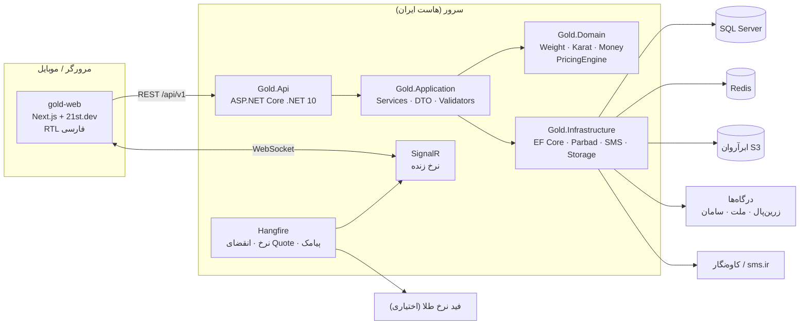
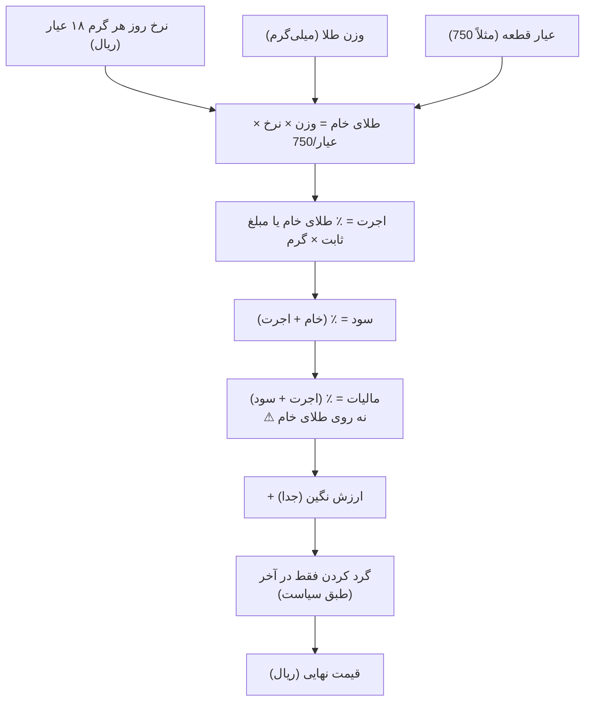
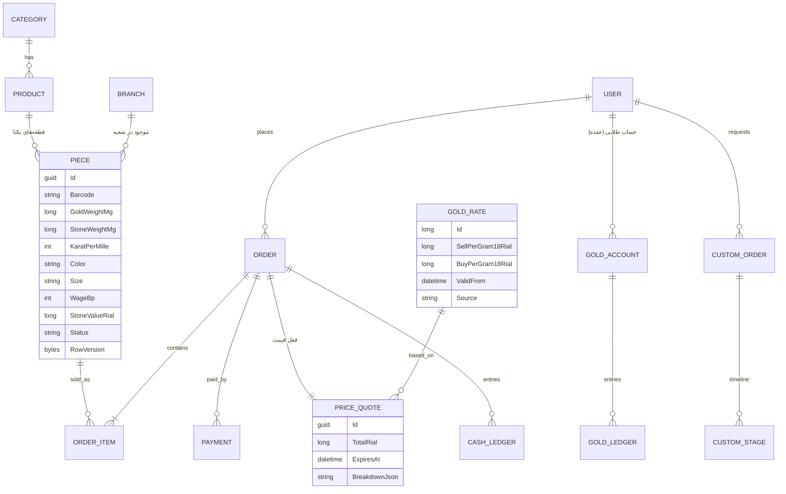
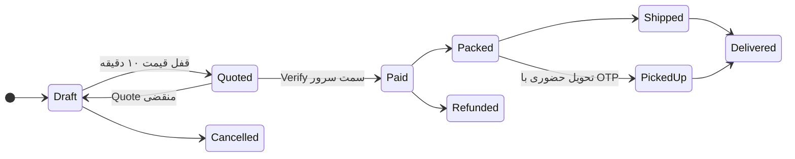
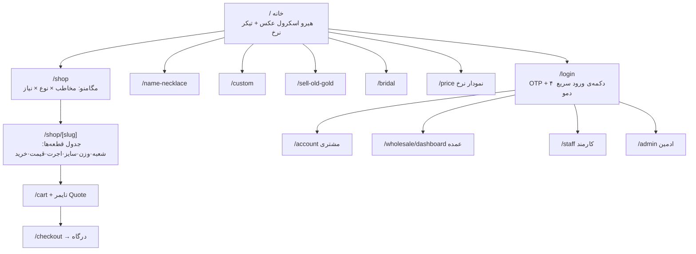

# 🗺️ PROJECT MAP — گالری و کارگاه طلا

> **قانون کار:** هر جلسه فقط همین فایل را اول بخوان. لازم نیست کل پروژه را اسکن کنی.
> بعد از هر تغییر مهم: «وضعیت»، «فهرست فایل‌ها» و «لاگ تصمیم‌ها» را همین‌جا به‌روز کن.
> نسخه‌ی تصویری همین نقشه: `docs/PROJECT_MAP.html` (در مرورگر باز کن).
> پرامپت کامل و مرجع نهایی نیازها: `docs/PROMPT.md` (فقط وقتی جزئیات یک بخش را لازم داری، همان بخش را بخوان).

مسیر روی کامپیوتر امیر: `C:\xampp\htdocs\gold`

---

## ۱. وضعیت (Status Board)

| # | مرحله | وضعیت | خروجی |
|---|---|---|---|
| 0 | تحقیق + نقشه + دیاگرام‌ها | ✅ | `docs/` |
| 1 | Domain + موتور قیمت + محافظ نرخ | ✅ | `src/Gold.Domain` — ۲۵ تست واحد |
| 1b | API + OTP + JWT/Refresh + نقش‌ها + ورود سریع دمو | ✅ | `src/Gold.Api` |
| 2 | نرخ روز + تنظیمات قیمت + کاتالوگ/قطعه (CRUD) + Seed دمو | ✅ | |
| 2b | **قالب White-label**: محتوای سایت از پنل، نصب خالی، `/setup`، دستیار ۹ قدمی، آپلود عکس | ✅ | `SiteService`، `/admin/site/*` |
| 3 | فرانت Next.js: خانه (اسکرول عکس)، فروشگاه، محصول، سبد، ورود، حساب، قیمت، طلای کهنه، تماس، پنل کامل | ✅ طراحی «عاج و مخمل» + موشن‌های 21st (@magicui)؛ ⚠ Zoom Parallax/گالری افقی بازسازی‌اند تا ورود به 21st | `src/gold-web` |
| 4 | Quote ۱۰ دقیقه + سفارش + پرداخت (درگاه آزمایشی) + Ledger ریالی + Outbox | ✅ | Parbad واقعی ⬜ |
| T | ۲۷ تست Integration + **۱۷ تست تصویری CRUD** (دسکتاپ + موبایل) | ✅ | `tests/` |
| 5 | پلاک اسم + سفارش ساخت با تایم‌لاین | ⬜ بعدی | |
| 6 | خرید طلای کهنه (نوبت ارزیابی) + تعمیرات | ⬜ (ماشین‌حساب ✅) | |
| 7 | پورتال عمده + Ledger طلایی + کارگاه | ⬜ | |
| 8 | اقساط/سازمانی + فاکتور رسمی + آداپتر Parbad و پیامک واقعی | ⬜ | |
| 9 | SignalR داشبورد + گزارش‌ها + CRM کارمند | ⬜ | |
| 10 | Docker + CI + Migration + دیپلوی | ⬜ | |

**قدم بعدی دقیق:**
1. بعد از ورود امیر به 21st، `slots/zoom-parallax.tsx` و `gallery/horizontal-gallery.tsx` را با کد اصلی عوض کن (قرارداد props یکی است).
2. مرحله‌ی ۵ (پلاک اسم + سفارش ساخت).

**اجرای تست‌ها:**
- `dotnet test`
- `bash tests/e2e/run-visual.sh` ← بعدش **حتماً** اسکرین‌شات‌های `tests/e2e/screenshots` را باز کن و نگاه کن.

---

## ۲. فهرست فایل‌ها (کجا چی هست)

```
gold/
├── CLAUDE.md · README.md · start-dev.cmd · start-empty.cmd · global.json (SDK 10)
├── GoldGallery.sln + GoldGallery.slnLaunch ← Visual Studio: F5 روی Gold.Api؛ SpaProxy خودش `npm run dev` را اجرا می‌کند (۳ پروفایل: دمو / نصب خالی / فقط API)
├── docs/ PROJECT_MAP.md/.html · PROMPT.md · SKILLS.md (همه‌ی استانداردها) · 21st-components.md
├── tools/ build_map.py · map_template.html · vendor/
├── src/Gold.Domain/
│   ├── ValueObjects/  Weight (mg) · Karat (‰) · Money (ریال) · Percentage (bp)
│   ├── Pricing/       PricingEngine · WageRule · RoundingPolicy · PricingPolicy · GoldRate+RateGuard
│   └── Entities/      User/Otp/RefreshToken · Category/Branch/Product/Piece · GoldRateEntry/PricingSettings
│                      PriceQuote/Order/OrderItem/Payment/CashLedgerEntry/AuditLog/OutboxMessage/SiteSetting
├── src/Gold.Application/
│   ├── Common/Result.cs · Abstractions/Interfaces.cs (IAppDbContext, IPaymentGateway, ISmsSender ...)
│   ├── Auth/AuthService      ← OTP، چرخش Refresh، ورود دمو، AvailableDemoRoles
│   ├── Rates/RateService     ← نرخ، تاریخچه، تأیید دوم جهش، تنظیمات قیمت
│   ├── Catalog/CatalogService← لیست با فیلتر/مرتب‌سازی، جزئیات + ریز قیمت، CRUD
│   ├── Orders/OrderService   ← Quote، سفارش (رزرو همزمان)، وضعیت، انقضا، طلای کهنه
│   ├── Payments/PaymentService ← شروع با Idempotency، Callback یکتا، Ledger
│   └── Site/SiteSections + SiteService ← محتوای White-label، onboarding، setup
├── src/Gold.Infrastructure/
│   ├── Persistence/ AppDbContext (Soft delete، Append-only، SQLite/SQL Server) · Configurations · DataSeeder
│   └── Services/    SystemClock · HmacSecretHasher · LogSmsSender (dev) · FakePaymentGateway (dev) · LocalMediaStorage
├── src/Gold.Api/
│   ├── Program.cs   ← fail-fast کلیدها، DemoLogin≠Production، RateLimiter، هدرهای امنیتی، Health
│   ├── Endpoints/   Auth · Catalog · Orders (+ درگاه آزمایشی /dev) · Site (+ /media)
│   ├── Security/ · Infrastructure/ (ProblemDetails، Validators فارسی، DevDatabase) · Realtime/RatesHub · Workers/
├── src/gold-web/ (Next.js 16 + Tailwind 4 + shadcn پایه)
│   ├── app/         صفحه‌ها: / shop shop/[slug] cart checkout/result login account price sell-old-gold contact setup
│   │                admin/: داشبورد · orders · products · categories · branches · pricing · site/[section]
│   ├── components/  header · footer · rate-ticker · role-switcher · maintenance · product-card · home-view
│   │                slots/zoom-parallax (⚠ بازسازی تا ورود به 21st) · admin/onboarding · admin/fields · ui/ (shadcn)
│   │   ├── ui21/    موشن‌های 21st (@magicui): blur-fade · text-animate · marquee · number-ticker · border-beam · shimmer-button · lens · scroll-progress
│   │   └── gallery/ horizontal-gallery (کلکسیون اسکرولی)
│   ├── public/img/  p (1200px) · hero (2560px) · 4k (3840px، اصل کانوا)
│   └── lib/         api.ts (توکن در حافظه + refresh) · site.ts · texts.ts (همه‌ی برچسب‌ها) · format.ts · cart.ts
└── tests/ Gold.UnitTests (25) · Gold.IntegrationTests (31) · e2e/ (Playwright: crud-visual + empty-install)
```

---

## ۳. معماری (دیاگرام)



قانون وابستگی: `Api → Application → Domain` و `Infrastructure → Application`. **Domain به هیچ چیز وابسته نیست.**

---

## ۴. موتور قیمت (قلب پروژه)



- همه‌ی درصدها در **واحد پایه (basis point = ۱/۱۰۰ درصد)** ذخیره می‌شوند: ۷٪ = 700. هرگز `double`.
- محاسبات میانی با `decimal`، خروجی `long` ریال.
- نمونه‌ی واقعی (ماوی گالری، ۲۶ مهر ۱۴۰۵): نرخ ۲۵٬۸۹۵٬۰۰۰ تومان، اجرت ۱۴٪، سود ۷٪، مالیات ۱۰٪ روی (اجرت + سود).
- خرید کهنه: `وزن × نرخ خرید (Bid) × عیار/750` — **بدون اجرت**.
- ⚠ نرخ مالیات/سود را قبل از راه‌اندازی با حسابدار و اتحادیه تأیید کن (هاردکد نکن؛ از پنل ادمین با تاریخ اعتبار).

---

## ۵. مدل داده (ERD — هدف)



---

## ۶. ماشین‌های وضعیت

```mermaid
stateDiagram-v2
  direction LR
  [*] --> Requested
  Requested --> Quoted: پیش‌فاکتور
  Quoted --> DepositPaid: بیعانه
  DepositPaid --> Designing
  Designing --> Casting: ریخته‌گری
  Casting --> Finishing: پرداخت
  Finishing --> StoneSetting: نگین‌کاری
  StoneSetting --> Hallmarked: انگ و عیارسنجی
  Hallmarked --> ReadyForPickup
  ReadyForPickup --> Delivered
```





خرید کهنه: `Booked → Assessed → OfferAccepted → Paid` یا `Rejected`.

---

## ۷. نقشه‌ی صفحات (Sitemap)



**ساختار منو (از تحقیق ماوی/روژا):**
- مخاطب: زنانه · مردانه · کودکانه
- نوع: انگشتر · دستبند · النگو · گردنبند · زنجیر · گوشواره · آویز/پلاک · پابند · ست و نیم‌ست · سکه/شمش
- رنگ: زرد · سفید · رزگلد
- نیاز: کم‌اجرت · سبک · پرفروش · لوکس · هدیه تا X تومان · سرمایه‌گذاری
- کارت محصول: «شروع از X تومان» + برچسب تخفیف اجرت + نمایش سریع + علاقه‌مندی

---

## ۸. موشن: اسکرول عکس (بدون ویدیو) — تصمیم امیر

| جا | کامپوننت 21st | اثر |
|---|---|---|
| هیرو خانه (مخمل تیره) | Zoom Parallax (`@efferd`, بازسازی) + Text Animate + Shimmer Button (`@magicui`) | ۷ عکس کانوا با اسکرول زوم می‌شوند |
| نرخ زنده | Number Ticker + Border Beam (`@magicui`) | عدد شمارنده با ارقام فارسی |
| دسته‌ها | Marquee (`@magicui`) | ردیف دایره‌ای عکس‌دار، توقف با هاور |
| کارت‌ها/تیترها | Blur Fade (`@magicui`) | ورود نرم با محو |
| کلکسیون منتخب | Horizontal Gallery (بازسازی الگوی 21st) | اسکرول عمودی → ریل افقی؛ موبایل swipe |
| روایت برند | پارالاکس عکس | عکس زرگر با اسکرول جابه‌جا می‌شود |
| صفحه‌ی محصول | Lens (`@magicui`) | ذره‌بین روی عکس 4K |
| سرویس عروس | Scroll Reveal Image (`@unlumen`, MIT) | عکس عریض و صاف می‌شود |
| «از طرح تا انگشتر» | Immersive Scroll Gallery (`@ishamsu`) | عکس‌ها با سرعت متفاوت بزرگ می‌شوند + متن |
| کالکشن‌ها | Horizontal Scroll (`@uilayout.contact`) | ردیف افقی با اسکرول عمودی |
| بنر دسته‌ها | Parallax Image (`@pulkitxm`) | پارالاکس ساده |

نصب: `npx shadcn@latest add "https://21st.dev/r/<author>/<name>?api_key=$API_KEY_21ST"` — ⚠ نیاز به کلید 21st امیر.

---

## ۹. قوانین ثابت (خلاصه)

- UI فارسی RTL؛ کد و کامنت انگلیسی.
- فرانت **فقط از 21st.dev**؛ هر کامپوننت در `docs/21st-components.md` ثبت شود.
- پول `long` ریال، وزن `long` میلی‌گرم، درصد `int` basis point — هرگز `double/float`.
- هیچ کلید/رمزی داخل کد نباشد.
- **هیچ امضا یا Co-Authored-By از AI در کامیت‌ها.**
- هر مرحله: کد → تست → build سبز → به‌روزرسانی همین نقشه.

---

## ۱۰. لاگ تصمیم‌ها

| تاریخ | تصمیم | دلیل |
|---|---|---|
| ۱۴۰۵/۰۷/۲۶ | ویدیو اسکرول حذف؛ موشن فقط با عکس | خواسته‌ی امیر؛ سبک‌تر روی اینترنت ایران |
| ۱۴۰۵/۰۷/۲۶ | صفحه‌ی محصول = جدول قطعه‌های یکتا با شعبه | الگوی ماوی گالری؛ هر قطعه وزن متفاوت دارد |
| ۱۴۰۵/۰۷/۲۶ | درصدها به basis point (int) | دقت مالی |
| ۱۴۰۵/۰۷/۲۶ | .NET 10 + Next.js 16 | پایدار، پشتیبانی بلندمدت |
| ۱۴۰۵/۰۷/۲۶ | SQLite برای اجرای لوکال، SQL Server برای سرور (`Database:Provider`) | روی کامپیوتر امیر بدون نصب کار کند |
| ۱۴۰۵/۰۷/۲۶ | ConcurrencyStamp (Guid) به‌جای RowVersion | روی هر دو دیتابیس کار می‌کند |
| ۱۴۰۵/۰۷/۲۶ | **White-label**: همه‌ی محتوا از پنل، نصب خالی + کد نصب + دستیار ۹ قدمی | خواسته‌ی امیر: فروش یک قالب به ۱۰ مشتری |
| ۱۴۰۵/۰۷/۲۶ | بدون کلید 21st: پایه‌ی shadcn (از گیت‌هاب) + اسلات موقت برای موشن | سایت 21st بدون کلید اجازه‌ی نصب نمی‌دهد |
| ۱۴۰۵/۰۷/۲۶ | فرانت از پشت Next rewrites به API وصل است (هم‌مبدا) | کوکی SameSite=Strict بدون CORS |
| ۱۴۰۵/۰۷/۲۶ | درگاه آزمایشی + پیامک لاگ در توسعه؛ Parbad/کاوه‌نگار بعداً | تست کامل بدون حساب واقعی |
| ۱۴۰۵/۰۷/۲۶ | EnsureCreated فقط در Development؛ Migration در مرحله‌ی ۱۰ | سرعت توسعه؛ Production فقط Migration بازبینی‌شده |
| ۱۴۰۵/۰۷/۲۷ | اجرا در Visual Studio با **SpaProxy** (نه esproj): Gold.Api سایت را روشن می‌کند و منتظر آماده شدنش می‌ماند | esproj روی کامپیوتر امیر npm را اجرا نکرد؛ SpaProxy روش قالب رسمی مایکروسافت است |
| ۱۴۰۵/۰۷/۲۷ | `DevDatabase`: اگر ساختار مدل عوض شده، دیتابیس SQLite توسعه خودکار از نو ساخته می‌شود | فایل gold.db قدیمی باعث خطای «no such table» می‌شد |
| ۱۴۰۵/۰۷/۲۷ | **طراحی جدید «عاج و مخمل»**: صفحه‌ها عاجی روشن، نوارهای عکس مخمل تیره، طلایی عتیقه (تم پیش‌فرض light؛ تم تیره هم در پنل) | امیر طراحی و رنگ قبلی را دوست نداشت |
| ۱۴۰۵/۰۷/۲۷ | موشن‌ها از 21st (`@magicui`، MIT، کد از گیت‌هاب) در `components/ui21` | کد 21st بدون ورود قفل است؛ منبع باز همان کامپوننت‌ها روی گیت‌هاب است |
| ۱۴۰۵/۰۷/۲۷ | عکس محصولات و هیرو از Canva AI، خروجی 3840px؛ `DevDatabase.SeedVersion` برای ساخت دوباره‌ی دیتای دمو | خواسته‌ی امیر: عکس 4K از کانوا |
| ۱۴۰۵/۰۷/۲۷ | بلوک‌های جدید خانه: `gallery` و `story` (از پنل روشن/خاموش) | گالری و روایت برند |
| ۱۴۰۵/۰۷/۲۷ | **Showcase** (`Showcase:Enabled`): دموی عمومی با ورود سریع، درگاه آزمایشی، نوار «نمایشی»، noindex، ریست خودکار هر ۶ ساعت، بدون نمایش OTP | انتشار دمو برای ارائه به مغازه بدون ریسک پول واقعی یا خرابکاری |
| ۱۴۰۵/۰۷/۲۷ | پروفایل داده‌ی `Seed:Profile=Moraveji` (گالری طلای مروجی، شیراز) از پیج‌های اینستاگرام خودشان | دمویی که صاحب مغازه وقتی ببیند عاشقش شود |
| ۱۴۰۵/۰۷/۲۷ | بخش‌های جدید سایت: `owner` (چهره‌ی برند: عکس، جمله، ویدیو، نکته) و `installments` (ماشین‌حساب اقساط) + واتساپ شناور | صاحب مغازه جلوی دوربین است؛ فروش اقساطی نقطه‌ی قوتشان است؛ سفارش‌ها از واتساپ است |
| ۱۴۰۵/۰۷/۲۷ | Docker تک‌کانتینری (API داخلی :5080 + Next standalone روی $PORT) + `render.yaml` | انتشار سریع روی Render |
| ۱۴۰۵/۰۷/۲۶ | تست تصویری CRUD بعد از هر مرحله + نگاه کردن به اسکرین‌شات‌ها | خواسته‌ی امیر؛ ۶ باگ واقعی پیدا کرد |

## ۱۱. سؤال‌های باز (از امیر بپرس)
1. ورود امیر به 21st.dev در مرورگر داخلی (برای کد اصلی Zoom Parallax و Horizontal Scroll)
2. اسم و پیج اینستاگرام طلاسازی واقعی (یا از پنل خودش پر کند)
3. منظور از «پیج سفر» = «صفر» (نصب خالی)؟ یا قالب برای کسب‌وکار دیگر؟

## ۱۲. API (خلاصه)

| گروه | مسیرها |
|---|---|
| عمومی | `GET /api/v1/site` · `GET /rates/current` · `GET /rates/history` · `GET /categories` · `GET /branches` · `GET /products?category&audience&color&minGrams&maxGrams&maxPriceRial&search&sort` · `GET /products/{slug}` · `POST /buyback/estimate` |
| ورود | `POST /auth/otp/request` · `POST /auth/otp/verify` · `POST /auth/refresh` · `POST /auth/logout` · `GET /auth/me` · `POST /auth/demo-login` · `GET /auth/demo-roles` |
| نصب | `GET /setup/status` · `POST /setup/init` |
| مشتری | `POST /quotes` · `POST /orders` · `GET /orders` · `GET /orders/{id}` · `POST /orders/{id}/payments` (Idempotency-Key) · `GET/POST /payments/callback` |
| کارمند | `GET/POST/PUT/DELETE /admin/products` · `/admin/pieces` · `GET /admin/orders` · `PUT /admin/orders/{id}/status` · `POST /admin/media` |
| ادمین | `POST /admin/rates` · `GET/PUT /admin/pricing-settings` · `/admin/categories` · `POST /admin/branches` · `PUT /admin/site/{section}` · `GET /admin/onboarding` · `GET /admin/ledger/summary` |
| سیستم | `/health/live` · `/health/ready` · `/hubs/rates` (SignalR) · `/media/{file}` · `/swagger` و `/dev/fake-gateway` (فقط Development) |
